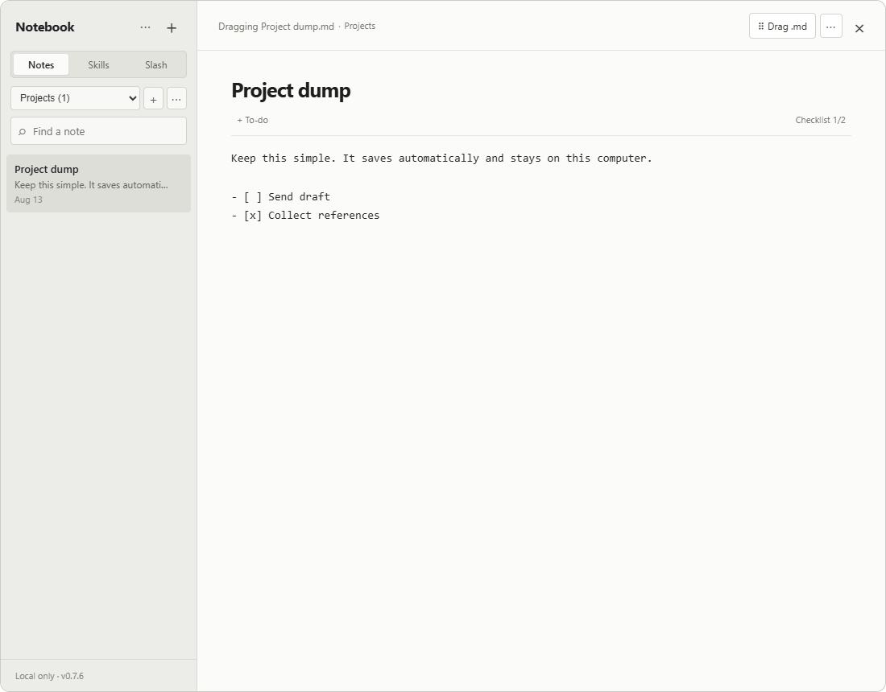

# Notebook

A tiny, local-first Windows overlay notebook. Press `Ctrl+Alt+Shift+N`, type, and carry on.



## What it does

- Opens compact and centered on the monitor under your cursor, always on top.
- Works over regular desktop apps and borderless/windowed games.
- Organizes Markdown notes into separate notebooks.
- Standard Markdown to-dos (`- [ ]`) with a clickable checklist view.
- Copies full Markdown, or drags a clean `Title.md` reference into terminals and other apps while the real file stays in local app data.
- Searchable **Skills** library with custom categories and autosaving instructions.
- Separate **Slash Commands** library with autosaving invocation and documentation pages.
- Rotating local backups; export/import JSON and Markdown from the `···` menu.
- Optional local LLMLingua compressor.

No account, cloud sync, telemetry, or auto-update service. Nothing leaves your computer.

## Install

Prebuilt Windows installers are distributed as manual downloads. To build one:

```powershell
npm install
npm run pack:dir       # portable unpacked build
npm run pack:release   # signed NSIS installer (requires signing credentials)
```

> Exclusive-fullscreen games can block normal Windows overlays. Use borderless/windowed mode for reliable use. Unsigned builds may trigger a Windows SmartScreen prompt.

## Develop

Requires Node.js 20+ and the .NET Framework 4.x C# compiler (for the drag helper).

```powershell
npm install
npm run dev            # build + launch the app
npm test               # storage, bounds, hotkey, startup, drag, and app tests
npm run preview        # browser UI preview at 127.0.0.1:5181
npm run shot           # render screenshots
```

See [CLAUDE.md](CLAUDE.md) for architecture, safety, and release instructions.

## Data

Your notes live at `%APPDATA%\note-overlay` — a `hushnote.sqlite` database plus rotating JSON backups in `backups`.

## License

[MIT](LICENSE) · derived in part from [FastNote](https://github.com/creamIcec/FastNote) (MIT), see [THIRD_PARTY_NOTICES.md](THIRD_PARTY_NOTICES.md).
